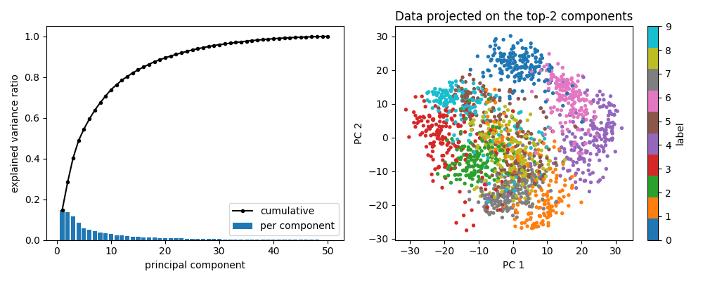
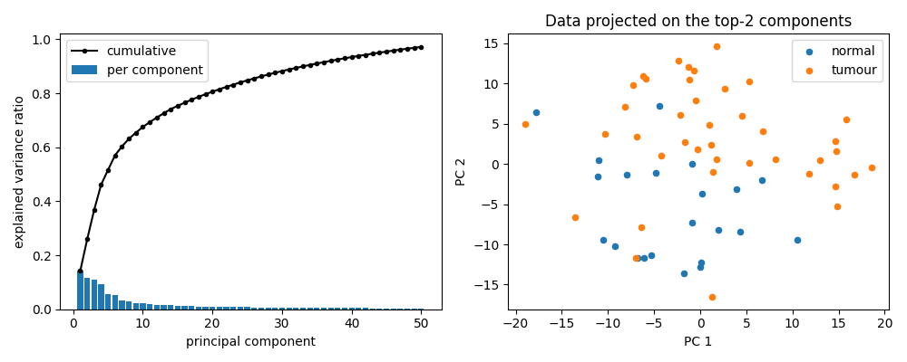
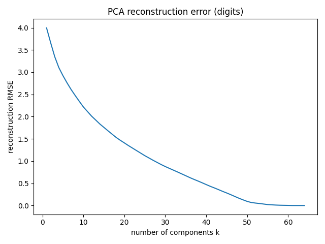
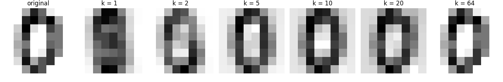
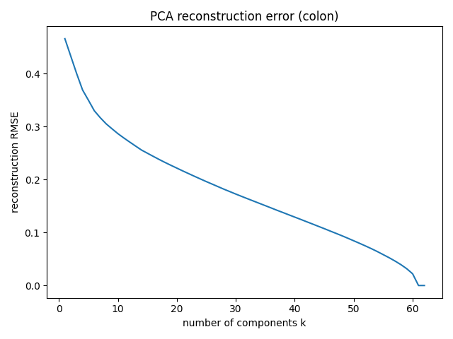

# Principal Component Analysis

Code (from scratch, in numpy/scipy) for Principal Component Analysis: the covariance eigen-decomposition, reconstruction error, and PCA through the SVD.

---

## Theory

Please note that the theory corresponding to the codes is hosted on this [page](https://parag1604.github.io/notes/Machine-Learning/Matrix-Factorization-and-Dimensionality-Reduction)

## Python Environment Setup

Use python >= 3.10 and install the requirements (numpy, scipy, scikit-learn and matplotlib):

```bash
pip install -r requirements.txt
```

## Data

Every script takes `--data {digits,colon,wide}`:

- `digits` (default): the 8x8 handwritten digits (1797 samples x 64 pixels) that ship inside scikit-learn.
- `colon`: the colon cancer gene-expression data of Alon et al. (1999),[^alon] 62 tissues (40 tumour, 22 normal) x 2000 genes. **The file is included in this repository** as `data/colon_cancer.csv` (1.6 MB), so `--data colon` works out of the box; `--path` points it at another copy. Layout: one header row, then one row per tissue with an id in the first column, the 2000 expression values, and the class label in the last column (1 = tumour, 0 = normal). The same data is also packaged in the Bioconductor package [colonCA](https://bioconductor.org/packages/colonCA/).
- `wide`: a synthetic stand-in with the same shape as the colon data (62 x 2000, a rank-5 signal plus noise), generated in memory.

## Running

### 0. PCA with the covariance eigen-decomposition

```bash
python version0.py
```

Centre the data, form the covariance matrix, and take its eigenvectors (principal directions) and eigenvalues (variances along them). On the digits, the top 2 components explain 28.5% of the variance, the top 10 about 74%, and the top 20 about 89%. Saves `pca_digits.png`, the explained-variance plot and the data projected on the top 2 components:



```bash
python version0.py --data colon
```

On the colon data the spectrum is flatter: the top 2 components explain 25.9% of the variance, the top 10 67.5% and the top 20 80.6%. The top two components alone do not separate tumour from normal tissue, though the normal samples tend to sit at negative PC 2:



### 1. Reconstruction error vs number of components

```bash
python version1.py
python version1.py --data colon
```

Project onto the top-k directions and map back. For every k, the script prints the reconstruction RMSE next to the value predicted from the discarded eigenvalues, $\sqrt{\frac{1}{D}\sum_{i>k}\lambda_i}$; the two match exactly (Eckart–Young). Saves `reconstruction_<data>.png` and, for the digits, one digit reconstructed with a growing number of components:





On the colon data the error reaches zero at k = 61 = N - 1, not at D = 2000: after centering, 62 samples span at most 61 directions.



### 2. PCA through the SVD, and the N << D trick

```bash
python version2.py --data wide      # or --data colon
python version2.py                  # digits, for comparison
```

The same top components are computed three ways: the D x D covariance, the SVD of the data matrix, and the N x N Gram matrix. The script checks that they agree and times them. On the colon data (62 samples, 2000 features) the Gram matrix took about 1 ms, the SVD about 9 ms and the 2000 x 2000 covariance about 560 ms, with all three agreeing to 1e-13; on the digits (N >> D) it is the other way round (covariance 0.6 ms, Gram 350 ms). After centering, at most N - 1 components are non-zero: the centred colon data has rank 61.

All numbers above are from runs on an Apple-silicon Mac (CPU, numpy/scipy), each script taking under a second.

[^alon]: Alon, U., Barkai, N., Notterman, D. A., Gish, K., Ybarra, S., Mack, D., and Levine, A. J. (1999). *Broad patterns of gene expression revealed by clustering analysis of tumor and normal colon tissues probed by oligonucleotide arrays*. PNAS 96(12): 6745-6750. [doi:10.1073/pnas.96.12.6745](https://doi.org/10.1073/pnas.96.12.6745)
